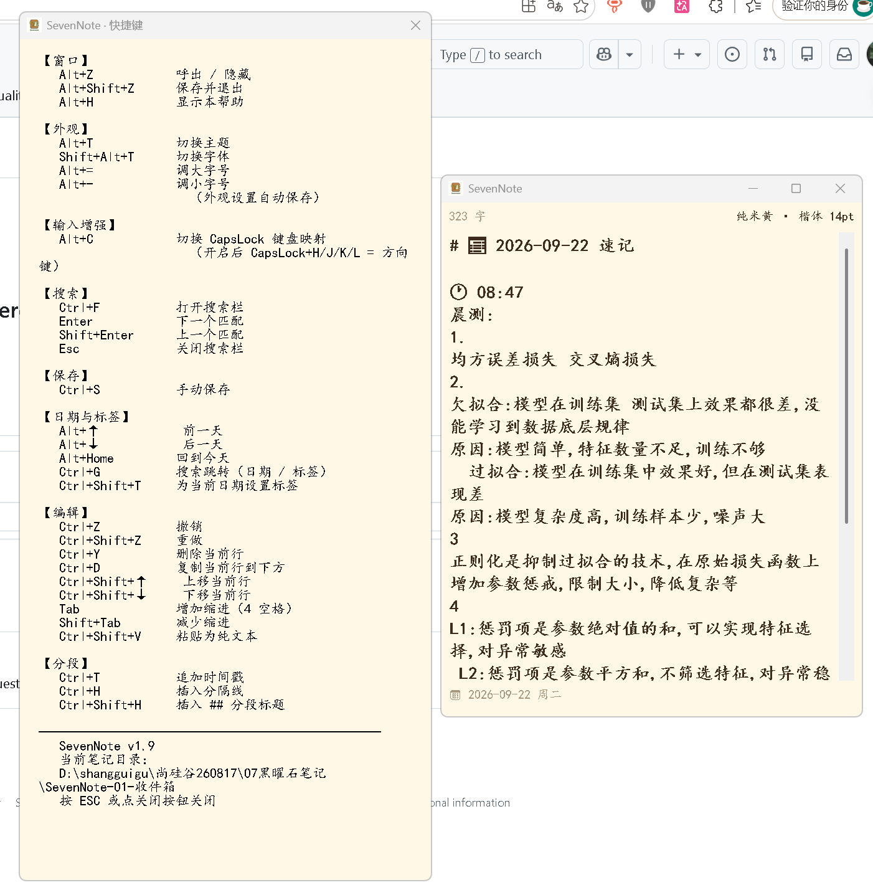
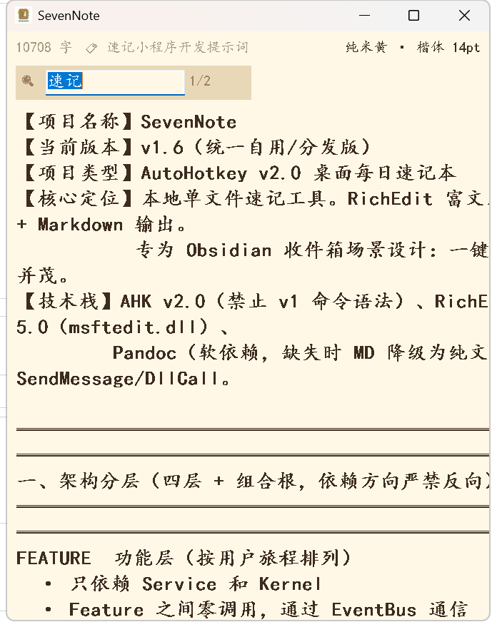
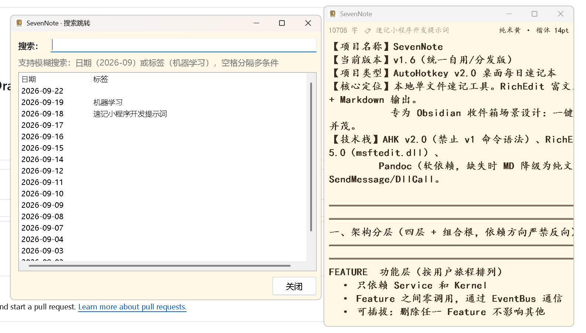

# SevenWork-AutoHotKey
Lightweight daily scratchpad for Windows (AHK v2): RichEdit editing, dual RTF storage, Pandoc → Markdown, Obsidian inbox. One hotkey, auto-save, image support, date tags.
# SevenWork

> 一键唤起的 Windows 本地速记工具 —— 富文本编辑 + 双 RTF 存储 + Markdown 输出
> 为 Obsidian 收件箱场景设计，走到哪记到哪，图文并茂、无感保存、标签管理
>
> 📄 **只想快速了解？** 看 [`docs/PROJECT-OVERVIEW.md`](./docs/PROJECT-OVERVIEW.md) —— 一页纸全景（定位 / 规模 / 欠账 / 限制）
> 🔧 **想看技术实现？** 看 [`docs/PROJECT-IMPLEMENTATION.md`](./docs/PROJECT-IMPLEMENTATION.md) —— 15 个技术块（RichEdit / GDI / Dwm / Launcher 契约…）
> 📄 **只想快速了解？** 看 [`docs/PROJECT-OVERVIEW.md`](./docs/PROJECT-OVERVIEW.md) —— 一页纸全景（定位 / 规模 / 欠账 / 限制）
> 🔧 **想看技术实现？** 看 [`docs/PROJECT-IMPLEMENTATION.md`](./docs/PROJECT-IMPLEMENTATION.md) —— 15 个技术块（RichEdit / GDI / Dwm / Launcher 契约…）
> 🧭 **想看工作台化路线？** 看 [`docs/WORKBENCH-PLAN.md`](./docs/WORKBENCH-PLAN.md) —— 三张归属表 + Phase 0–6
> 📋 **版本历史** [`docs/CHANGELOG.md`](./docs/CHANGELOG.md) ｜ 🗓 **决策日志** [`docs/DEVLOG.md`](./docs/DEVLOG.md)
> 🎨 **主题出图** [`docs/THEME-IMAGES.md`](./docs/THEME-IMAGES.md) ｜ 🪟 **外部窗口适配** [`docs/LAUNCHER-GUIDE.md`](./docs/LAUNCHER-GUIDE.md)


## 界面预览

### 主界面


### 帮助页面


### 检索页面


### 日期跳转


### 主题字体切换


### 在 Obsidian 中回顾


---

## ✨ 为什么用 SevenWork

### 痛点

你是否有过这些体验：

- 想记点什么，**打开笔记软件要 3~5 秒**，灵感已经跑了
- 记录时想**加粗重点、插张图、标个颜色**，结果只有纯文本
- 记完的笔记**散落在时间线里**，一个月后完全想不起哪天记过什么
- 已有的笔记软件要么**太重**（100MB 内存起步），要么**太轻**（不支持富文本）
- 同步到 Obsidian 时**图片链接全丢**，格式乱成一团

### SevenWork 的答案

| 你的需求 | SevenWork 的做法 |
| --- | --- |
| **秒级唤起** | 全局热键 `Alt+Z`，100ms 内呼出/隐藏，不打断工作流 |
| **富文本编辑** | 基于 RichEdit：加粗、颜色、字体、内嵌图片，一个不少 |
| **图片随手粘** | `Ctrl+V` 直接粘图，自动存 PNG，自动生成 Markdown 链接 |
| **能一眼找到** | 每天一个标签，写在文件名里：`2026-09-20-机器学习.md` |
| **和 Obsidian 无缝** | 自动生成 `.md` + `_assets/日期/` 图片目录，Obsidian 直接读 |
| **不丢数据** | 定时 / 隐藏 / 切日期 / 粘贴 自动保存，空笔记不落盘 |
| **轻量不打扰** | 单 EXE ~250MB（含 Pandoc），运行内存 ~10MB，纯 Windows 原生 |

---

## 🎯 核心特性

### 🪶 极致轻量

- **启动 < 100ms**：双击即用，不拖累系统
- **内存 ~10MB**：常驻后台无感
- **单文件分发**：`SevenWork.exe` 一个文件，无需安装
- **零依赖运行**：EXE 版内置 Pandoc，用户无需装任何东西

### 📝 富文本编辑

- 加粗、斜体、颜色、字体大小，随时切换
- **`Ctrl+V` 直接粘图**，自动存到 `_assets/日期/`
- **`Ctrl+Shift+V` 粘贴纯文本**，剥离外部格式
- **Tab 缩进不丢字符格式**（很多编辑器做不到这点）

### 💾 双格式归档

保存时同时输出两种格式，各取所需：

```
936 RTF（GBK）   → WPS / Word / 写字板 打开都正常
65001 RTF（UTF-8） → 给 Pandoc 转 Markdown
最终产物：
  .rtf  富文本母版（保真）
  .md   Markdown 译本（便携）
  _assets/日期/  图片附件
```

### 🏷️ 标签系统

**标签写在文件名里**，黑曜石里见名知意：

```
无标签：  2026-09-20.md
有标签：  2026-09-20-机器学习.md
```

- `Ctrl+Shift+T` 一键设标签
- 顶部状态栏常驻显示：`🏷 机器学习`
- `Ctrl+G` 统一搜索日期 / 标签，双击跳转

### 🗓️ 日期管理

- `Alt+↑ / Alt+↓` 前后一天
- `Alt+Home` 一键回今天
- **状态栏显示星期**：`📅 2026-09-20 周日`
- **切日期自动定位到开头**（不是末尾）
- **空笔记不落盘**：Vault 永远干净

### 🎨 5 套主题 + 7 种字体

- **主题**：纯米黄 / 护眼绿 / 纸白 / **星空** / **金克斯**
- **字体**：楷体 / 华文行楷 / 华文新魏 / 方正舒体 / 仿宋 / 微软雅黑 / 黑体
- **字号**：12 / 14 / 16 / 18 / 20 pt
- **`Alt+T` 切主题，`Alt+Shift+T` 切字体，`Alt+=/-` 调字号**
- 全部自动记忆，重启保留
- 最后两套是**背景图主题**：切到它们，一张图片铺满编辑区，文字**直接浮在图上**
- 两套都走「**暗图 + 亮字**」：图不动明暗（只把压在字下的最亮处滚降一点），窗框 / 标题栏 /
  状态栏一起转深，人物（星空是星云）铺满编辑区

### 🖼 背景图主题（星空 / 金克斯）

**背景图不是全局开关，而是与其它 3 套并列的第 4、5 套主题。** `Alt+T` 轮到它们时，一张图片
铺满编辑区，文字**直接浮在图上**（终端式，不是相框式）。

- 切到带图的主题就铺图，切到其它 3 套会**自动撤掉图**、回到纯色底 —— 想关背景图就切主题
- 两套都用**等比铺满**（cover）：只裁不压，铺进近方形的编辑区不会被压扁。竖版人物图
  （0.676）和编辑区（0.917）比例差得远，靠**烘焙时先裁好再铺**，而不是运行时用
  `bgFit: "contain"` 把它缩进中间 —— 那样两侧会留一大条底色、人物显小
- 两套都走「**暗图 + 亮字**」，这不是偏好，是量出来的：
  - 「星空」星云均亮只有 28；「金克斯」原图均亮 **75**。两者都远低于亮字那条线
    （背景 ≤ 118），**本来就该配亮字，根本不需要提亮**。正文取近白 `#F5F9FF` / `#EAF2FF`，
    次级文字 `#9FAABC` / `#93AACB`
  - 「金克斯」只有一处例外：脸、手和那片白雾亮到 254，亮字压上去会糊。所以烘焙时把
    **最亮的 15% 滚降**（`V > 116` 的部分线性压到 152），暗部一个像素都不动 ——
    全图均亮度 75.1 → **74.9**，看上去就是原图本身，而亮度 >118 的像素从 20.5% 降到 9.1%
- ⚠️ **上一版走过的弯路**：为了迁就「深色字」，把这张图整体抬亮到均亮 170 ——
  结果整张图"蒙了层灰"、和原图完全不像。**提亮不等于清晰，它是把原图洗白。**
  暗图就该配亮字。混白（加法提亮）更糟：实测把最彩 5% 像素的饱和度从 45.8% 砍到 26%
- 配色取自图本身：星空取全图均色 `#181C25` → `#0D0F14`；金克斯取冷调（`B > R`），
  窗框 / 编辑区 / 搜索条 `#0B1624`（比图的暗部再蓝一档），正文 `#EAF2FF`、次级 `#93AACB` ——
  四个色压在同一色族里，窗口、标题栏、编辑区一起转深，没有色块割裂感
- 标题栏**整块取主题色**：`win` 的加权亮度 < 128 就开 immersive dark mode（Win10 只有这一档），
  Win11 上再进一步 —— 用 `DWMWA_CAPTION_COLOR / TEXT_COLOR / BORDER_COLOR`(35/36/34) 把标题栏
  底色染成 `win`、标题文字染成 `text`、外框同 `win`。实测标题栏像素精确等于 `#0B1624`，
  和窗框连成一体
- **编辑区滚动条也跟着主题**：滚动条画在**非客户区**、由系统主题上色，深色主题下原来会留一条
  亮白竖条压在暗底上（浅色主题下则相反）。`ThemeService._SetScrollBarTheme` 把编辑区窗口主题
  设成 `DarkMode_Explorer` / `Explorer` 即随主题明暗 —— 实测滚动条区域的像素均亮度 **40**
  （编辑区 75，同档暗）、**亮像素 0 个**
- **上下滑动时不再频闪**：主窗口开了 `WS_EX_COMPOSITED`（`+E0x02000000`）离屏双缓冲 ——
  编辑区 RichEdit 自身不带双缓冲，滚动时会先擦一遍客户区再画文字，那一帧空档正是「滑动时
  略微频闪」的来源；合成重绘后父子控件的绘制顺序由系统统一保证
- 改窗口大小、切主题、开搜索栏都会按编辑区的新位置重新铺图
- 图片缺失时自动降级为纯色底（`edBg`），文字照样读得清

想再加一套**别的图**当主题（极光、雪原……）？见
[开发指南 → 添加带背景图的主题](#添加带背景图的主题)，配 `tools\pick-theme-colors.ps1` 一键取色。

**换图 / 调浓淡**都改**主题自己**：`ThemeService.Themes` 里那一条的 `bg`（图路径）与
`bgAlpha`（遮罩不透明度 0-100；遮罩色取该主题 `edBg`，暗主题压暗、亮主题加白纱）。
不设全局开关 —— 多套图主题才能各调各的（换图后**重启程序**才生效，位图有缓存）。

### ⌨️ 输入增强

- `CapsLock+H/J/K/L` = 方向键（`Alt+Shift+C` 开关）
- 写长文时手不离主键区
- 可选，不影响正常 CapsLock 使用

### 📂 文件夹快捷槽位

`Alt+1 / Alt+2 / Alt+3` 各绑一个目录：按一下呼出、再按一下收起，和 `Alt+C` 终端同一套显隐逻辑
（开着但不在前台时只激活、不收起 —— 免得「按一下就没」）。

槽位指向哪个目录**不写死**：`Alt+S` 面板里选「文件夹」，点「浏览…」换一个目录，保存即生效。

- 浏览窗口是**新版**文件夹对话框（`BIF_NEWDIALOGSTYLE`）：带地址栏，可以直接把 `D:\Work`
  粘进去，全盘任意位置一步可达；上次浏览到的目录会被记住；
- 起点按「输入框里的现有值 → 上次浏览的目录 → `D:\` → 我的文档」挑 —— 本机有 D 盘就从 D 盘起步；
- 定位靠资源管理器的**真实路径**（读 `Shell.Application`），不靠窗口标题 ——
  两个同名的 `Documents` 也不会认错，中英文系统的表现一致；
- 三个槽位默认留空（输入框里有灰字提示），按下会直接打开面板并停在「文件夹」页引导你设置；
- 面板**不置顶**、保存按钮会亮出「✓ 已保存」—— 前者保证浏览对话框不会被压在面板下面，
  后者保证「点了到底有没有生效」看得见；
- ⚠ 属于全系统热键，会占用其它程序的 `Alt+1/2/3`。

### 📄 选中的文件转 Markdown

在资源管理器里选中一个或多个文件，按 `Alt+M`，每个文件在同级目录生成一个同名 `.md`（pandoc 转换）。

- 认得的输入格式跟着 pandoc 走：`docx` / `odt` / `rtf` / `epub` / `html` / `pptx` / `xlsx` / `csv` / `ipynb` 等；
  ⚠ `pdf` 与老式 `doc` **转不了**（pandoc 根本没有这两种输入格式），会明确提示「先另存为 .docx 再转」；
- **已存在同名 `.md` 就跳过、不覆盖** —— 那很可能是你自己写的笔记。想重转，删掉旧的再按一次；
- **标题层级会被保住**，哪怕源文档用的是自定义样式名：pandoc 只认 Word 的
  `heading 1..9`，而国内课件常自定义「二级标题」「三级标题」「半括号标题（五级）」
  这类名字 —— 直接转会一个标题都没有，整篇塌成嵌套列表、编辑器大纲是空的。
  本功能转换前会先复制一份 docx、把那几个样式名规范化成 `heading N` 再转，
  **源文件一个字都不改**（实测 23MB 课件：0 个标题 → 223 个，逐级对得上）。
  标题一律写成 ATX（`## 标题`），不用 `====` / `----` 下划线式 —— 后者很多编辑器的大纲不认；
- 文档里的图片会抽到同级 `<文件名>_media\`，md 里的链接写成**相对路径**，
  把 md 与这个目录一起搬走 / 发给别人都不会丢图；
- 只在**资源管理器是前台窗口**时响应 —— `Alt+M` 在 Excel / Word 里有自己的用途，不去抢；
- 结果是一个 3 秒的 ToolTip：单个文件给具体原因（「已转换：X.md」/「已存在同名 .md，跳过」），
  多个文件给数量汇总（「已转换 3 个 · 跳过 1 个」）。失败时 ToolTip 只有一句结论，
  退出码等细节写进 `.logs\_error.log`。

---

## 🚀 快速开始

### 方式 A：使用 EXE（推荐普通用户）

1. 从 [Releases](../../releases) 下载 `SevenWork.zip`（约 40MB，解压后得到 SevenWork.exe）
2. 放到任意非系统盘目录（如 `D:\tools\`）
3. **关闭杀毒软件**（AHK 编译的 EXE 常被误报）
4. 双击运行
5. 首次弹框 → **选择笔记存储目录**（如 `D:\我的笔记\SevenWork`）
6. 按 `Alt+Z` 呼出 → 开始使用

### 方式 B：使用源码（推荐开发者）

1. 安装 [AutoHotkey v2](https://www.autohotkey.com/)
2. 安装 [Pandoc](https://mirrors.lzu.edu.cn/)（国内镜像，选 `x86_64` 版）
3. 把整个项目目录放任意位置，双击根目录的 `SevenWork.ahk`（极简启动器，运行代码统一在 `src/`）
4. 首次运行会弹框让你选笔记目录

仓库里的其它东西：

| 路径 | 用途 |
| --- | --- |
| `SevenWork.ahk` | 根目录启动器：把入口转给 `src\`，并保持 `A_ScriptDir` 指向项目根 |
| `src\SevenWork.ahk` | 组合根：装配 + 启动 |
| `src\WorkBench\` | 平台层：Kernel / 热键路由 / 模块登记 / 统一帮助 / 伙伴协调 |
| `src\modules\SevenNote\` | 笔记模块：7 个 Service + `StatusBar` + 18 个 Feature + 模块生命周期 |
| `src\modules\Launcher\` | 外部程序模块：`PeerLayoutService` + PowerShell / DeepSeek Feature + 模块生命周期 |
| `src\modules\KeysInput\` | 键位模块：`CapsLockFeature` + 模块生命周期 + `Alt+Shift+C` |
| `src\modules\Text\` | 文本模块：提示词库（`Alt+P`）—— 2 个 Feature + `PromptStoreService` + 模块生命周期 |
| `src\modules\Folders\` | 文件夹模块：`Alt+1/2/3` 三个槽位（不建自己的窗口，只驱动资源管理器）+ `Alt+M` 选中文件转 Markdown |
| `docs\legacy\SevenNote.v2.4.3.ahk` | Phase 2 拆分前的单文件快照（只作对照，不参与运行） |
| `tools\` | 开发辅助脚本，如 `pick-theme-colors.ps1` 从壁纸取主题配色 |
| `docs\screenshots\` | README 配图 |
| `docs\` | 项目文档：`DEVLOG.md`（开发日志）、`PROJECT-OVERVIEW.md`（一页纸全景）、`PROJECT-IMPLEMENTATION.md`（技术清单）、`WORKBENCH-PLAN.md`（工作台化路线） |
| `.clinerules\` | 架构约定与踩坑记录（`05-theme-image.md` 是「看图生成主题」的配方 + 偏好） |

---

## ⌨️ 快捷键一览

### 全局热键（任何程序中都生效）

| 热键 | 功能 |
| --- | --- |
| `Alt+Z` | 呼出 / 隐藏 |
| `Alt+Shift+Z` | 保存并退出 |
| `Alt+C` | 呼出 / 隐藏 PowerShell，笔记窗口自动与它上下对齐成规整一列 |
| `Alt+X` | 呼出 / 隐藏 DeepSeek 网页（**独立 profile 的普通 Edge 窗口**，标签栏与工具栏齐全，窗口内可直接浏览网页），同样自动与笔记对齐 |
| `Alt+S` | 打开**工作台面板**：左侧导航选页（`≡ 全部热键` / 各模块），右侧看该页热键、直接改该模块的设置 |
| `Alt+↑ / Alt+↓` | 前一天 / 后一天 |
| `Alt+Home` | 回到今天 |
| `Alt+T` | 切换主题（含两套背景图主题「星空 / 金克斯」） |
| `Shift+Alt+T` | 切换字体 |
| `Alt+= / Alt+-` | 调大 / 调小字号 |
| `Alt+Shift+C` | 切换 CapsLock 键盘映射 |
| `Alt+P` | 呼出 / 隐藏**提示词库**（片段库，数据在 `<Vault>\_prompts\`） |
| `Alt+1 / Alt+2 / Alt+3` | 呼出 / 隐藏**文件夹槽位 1 / 2 / 3** —— 指向哪个目录在 `Alt+S` 面板里换，留空表示该槽位未启用 |

> ⚠ `Alt+1/2/3` 是**全系统**热键，会占用其它程序的这三个组合。三个槽位默认留空，
> 第一次按下会直接打开工作台面板并停在「文件夹」页，指着旁边的「浏览…」选一个目录即可。

### 资源管理器内热键（窗口激活时）

| 热键 | 功能 |
| --- | --- |
| `Alt+M` | 把选中的文件转成同名 Markdown（存到同级目录；已有同名 `.md` 则跳过、不覆盖） |

> `Alt+M` 只在资源管理器是**前台窗口**时生效 —— 它在 Excel / Word 里有自己的用途，
> 全局注册会把人家按菜单的那一下抢走。

### 编辑器内热键（窗口激活时）

| 热键 | 功能 |
| --- | --- |
| `Ctrl+S` | 手动保存 |
| `Ctrl+Z / Ctrl+Shift+Z` | 撤销 / 重做 |
| `Ctrl+Y` | 删除当前行 |
| `Ctrl+D` | 复制当前行到下方 |
| `Ctrl+Shift+↑ / ↓` | 上移 / 下移当前行 |
| `Tab / Shift+Tab` | 增加 / 减少缩进（不丢格式） |
| `Ctrl+Shift+V` | 粘贴为纯文本 |
| `Ctrl+T` | 手动追加时间戳（v2.4 起不再自动加） |
| `Ctrl+H` | 插入按编辑区宽度动态生成的分隔线 |
| `Ctrl+Shift+H` | 插入 `## 分段` 标题 |
| `Ctrl+F` | 打开搜索栏 |
| `Ctrl+G` | 搜索跳转（日期 / 标签） |
| `Ctrl+Shift+T` | 为当前日期设置标签 |

### 搜索栏内

| 热键 | 功能 |
| --- | --- |
| `Enter / Shift+Enter` | 下一个 / 上一个匹配 |
| `Esc` | 关闭搜索栏 |

### 提示词库内（`Alt+P` 呼出后）

| 热键 / 操作 | 功能 |
| --- | --- |
| `Enter` | 进入编辑窗口（改标题 / 分类 / 正文，也能删） |
| 双击某行 | 直接复制到剪贴板**并关掉窗口**（不进编辑）—— 拿到就走，直接去粘贴 |
| `Ctrl+N` | 新建提示词 |
| `F5` | 重新扫描 `_prompts\`（在外部编辑器里改过文件时用） |
| `Esc` | 关闭 |

编辑窗口内：`Ctrl+S` 保存、`Esc` 取消（不保存）。单击只选中 —— 既不复制也不进编辑，
所以选错了不会覆盖你正在粘的东西；想拿内容用**双击**（复制完窗口自己收起，鼠标旁闪一句
「已复制「X」」），想改内容按 `Enter`。复制失败时窗口**不**收，原因留在状态行里。

**「分类」是可编辑下拉**：展开时列出 `_prompts\` 下现有的目录（含空目录，多级显示成
`Code/代码审查`），也可以直接敲一个新分类 —— `Work/会议` 这种多级会自动建目录。
上一次保存用过的分类会自动填进下一条新建，省得每条都重选；重启回落到「未分类」。

**删除是就地二次确认**：点「删除」按钮 → 它变成「确认删除」，下方提示行红字提醒
「3 秒内有效」；3 秒内再点一次才真删，超时 / 关窗 / 保存都会自动复原。这里**故意不弹框** ——
编辑窗口是置顶的，模态框会被压在它后面，看起来就是「点了没反应」。

---

## 📁 文件结构

### Vault 目录（你的笔记）

```
你的Vault/
├── 2026-09-20.rtf                富文本母版
├── 2026-09-20.md                 Markdown 译本
├── 2026-09-20-机器学习.rtf        带标签的富文本
├── 2026-09-20-机器学习.md         带标签的 Markdown
├── _assets/                      ★ 图片统一收纳
│   ├── 2026-09-20/
│   │   └── image1.png
│   └── 2026-09-19/
│       └── image2.png
├── _tmp/                         pandoc 临时目录（自动清理）
└── _prompts/                     ★ 提示词库（Alt+P 呼出）
    ├── Chat/                     目录名 = 分类
    │   └── 角色设定.md           文件名 = 标题，文件全文 = 正文
    ├── Code/
    │   └── 代码审查/              子目录 = 多级分类（Code\代码审查）
    │       └── 清单.md
    └── 随手记.md                 根目录下的文件 = 未分类
```

> `_prompts\` 是**普通目录 + 普通 markdown 文件**，没有数据库、没有 front matter：
> 用 VS Code / Obsidian 直接改，用 git 直接备份。分类就是文件夹 —— 想加分类就在资源管理器里
> 建一个，或新建提示词时在「分类」里写 `Work/会议`。首次运行会播种 `Chat` / `Code` / `Work`
> 三个空目录当起步结构，之后完全自由。想换位置就在 `_config.ini` 写
> `[Paths] PromptsDir=D:\你的路径`（非空即覆盖默认的 `<Vault>\_prompts`）。
```

### 配置目录（AppData）

程序用**两个**目录，故意分开：

```
C:\Users\<用户名>\AppData\Roaming\SevenWork\
├── pandoc.exe                    内嵌的 Pandoc（仅 EXE 版，100+MB，跨身份共用一份）
├── _config.ini                   配置（几百字节）
└── _error.log                    出错日志（只在真出错时才出现，超 512KB 自动轮转）

C:\Users\<用户名>\AppData\Roaming\SevenWork-Dev\
└── _config.ini                   开发身份的配置（Vault 通常指测试库）
```

⚠️ **身份由「工作树根有没有 `_dev.flag`」决定**（`Config.IsDev`；该文件在 `.gitignore` 里、
不入库）：**没有 = 日用 / 编译版**，读写 `SevenWork\`；**有 = 开发工作树**，读写 `SevenWork-Dev\`。
所以两条分支的源码完全一致，身份跟着**目录**走，不跟分支走。

⚠️ **开发身份的报错日志不在这里**，而是落在**工作树根的 `.logs\_error.log`**
（`Config.LogPath`）—— 开发时一眼就能翻，`.gitignore` 已忽略 `.logs/`；从 `src\SevenWork.ahk`
起手（调试 / 探针）时落 `src\.logs\`。编译后 exe 可能在桌面 / U 盘 / `Program Files`，
那里要么脏用户目录、要么没有写权限，所以编译版始终落 AppData。项目目录不可写时会退回 AppData 再记一次。

⚠️ **`SevenWork-Dev` 是开发身份的配置目录**（`Config.ConfigPath`）。`_config.ini` 存的是
使用者状态（主题 / 字体 / Vault 路径），按身份隔离更安全：两边各改各的、不互相覆盖。
`pandoc.exe` 太大、又不随版本变，所以留在 `SevenWork\` 共用 —— 源码里
`Config.PandocPath` 与 `Config.ConfigPath` 指向不同目录**不是笔误**。

⚠️ **`_config.ini` 里可能残留不再被读取的键**（历史版本留下的，例如 `[Appearance]`
`BackdropOn`）。程序只读 `ConfigService.SetDefault` 里声明过的键，多余的键既不读也不报错，
删不删都行 —— **别因为某个键在代码里搜不到就当成"漏接线"**。

⚠️ **配置在进程内被缓存**（v2.4.2 起）：`ConfigService.Read` 读一次就记住，之后不再碰磁盘 ——
`Config.GetVault()` 在单次保存里就要被调 6 次以上（`FindRtf` / `DefaultRtfPath` / `FindMd` /
`DefaultMdPath` / `TempDir` / `AssetsDir`），每次都读盘不值当。代价是**运行期手改
`_config.ini` 不会立刻生效，改完请重启程序**（程序自己写配置的路径会同步缓存，
所以主题 / 字体这类在程序内切换的照旧即改即用）。

### 笔记内容示例

```markdown
# 📅 2026-09-20 速记

🕐 09:15
今天开会讨论了三件事：
- 项目进度
- 人员安排
- 下周计划


🕐 14:30
下午想到一个点子……
```

---

## 🔧 技术特色

### 架构：四层 + 组合根

```
┌─────────────────────────────────────────────────────┐
│ FEATURE  功能层（21 项，按用户旅程排列）             │
│  · Feature 之间零调用，通过 EventBus 通信            │
│  · 可插拔：删除任一 Feature 不影响其他               │
├─────────────────────────────────────────────────────┤
│ SERVICE  服务层（8 项，纯能力）                     │
│  · 无业务、无时间、无理由                            │
│  · 被多个 Feature 共用                              │
├─────────────────────────────────────────────────────┤
│ KERNEL   骨架层（4 项）                             │
│  · 生命周期 / 状态 / 事件 / 配置                     │
│  · 冻结，只加不改                                    │
├─────────────────────────────────────────────────────┤
│ 表示层：StatusBar  ·  组合根：装配 + 启动            │
└─────────────────────────────────────────────────────┘

依赖方向：Feature → Service → Kernel → OS（严禁反向）
```

### 三个核心设计决策

**1. 用 `EM_STREAMOUT/EM_STREAMIN` 直读直写 RTF**

不碰剪贴板（剪贴板是程序间共享资源，用它做进程内私有通道会引发并发竞争）。所有保存/加载都走 Win32 消息，稳定、无副作用。

**2. 用 Pandoc 转换 RTF → Markdown**

不自研解析器（原版 150 行自研解析器脆弱，依赖隐式约定）。Pandoc 成熟稳定，图片位置按 RTF 结构精确提取。

**3. 双 RTF 输出（936 + 65001）**

RichEdit 只输出非标编码，Pandoc/Word 认的标准不同——**三方各有死结**。只能每次保存输出两份 RTF，各给一方。

### 代码与数据分离

| 类别 | 位置 | 备份 |
| --- | --- | --- |
| **代码** | `SevenWork.exe`（放哪都行） | ❌ 不需 |
| **笔记数据** | Vault 目录（用户选的） | ✅ **只需备份这个** |
| **程序配置** | `%AppData%\SevenWork\_config.ini`（开发工作树为 `%AppData%\SevenWork-Dev\`） | ⚠️ 可选 |
| **内嵌 Pandoc** | `%AppData%\SevenWork\pandoc.exe` | ❌ 自动释放 |

**备份策略**：只拷 Vault 目录，其他丢了都能重建。

---

## ❓ 常见问题

### Q1：双击 `.ahk` 报"此应用无法在你的电脑上运行"

装的是 **AutoHotkey v1**（不是 v2），或装了 **ARM64 版**。

**修复**：
1. 卸载现有 AutoHotkey
2. 下载 x64 版：`https://www.autohotkey.com/download/ahk-v2.exe`
3. 安装后重试

**验证**：托盘图标右键 → About → 版本必须是 v2.0.x

### Q2：保存时报"此应用无法在你的电脑上运行"

`%AppData%\SevenWork\pandoc.exe` 是**坏文件**（0KB / ARM64 / 损坏）。

**修复**：
1. Win+R → `%AppData%\SevenWork` → 回车
2. **删除** `pandoc.exe`
3. 下载 x86_64 版 pandoc，放到该目录
4. 重启 SevenWork

**临时方案**：删掉 `pandoc.exe` 不装 → 保存降级为纯文本 `.md`，笔记不丢。

### Q3：粘贴图片后 `.md` 里没有图片

Pandoc 不可用，走了降级路径。

**排查**：cmd 运行 `"%AppData%\SevenWork\pandoc.exe" --version`：
- 显示版本号 → pandoc OK，可能是图片是 OLE 对象（从 Word 复制的）→ 改用 `Win+Shift+S` 截图后粘贴
- 报错 / 找不到 → 装 x64 版 pandoc

### Q4：`.rtf` 文件全篇带下划线

**32 位编译**导致的（加载了 32 位 `msftedit.dll`）。

**修复**：用 **64 位 Unicode** 重新编译。

### Q5：找不到 Vault 路径

- `Alt+S` → 帮助窗口底部显示"当前笔记目录"
- 或看 `%AppData%\SevenWork\_config.ini` 里的 `Vault=`（开发工作树为 `%AppData%\SevenWork-Dev\`）

**换 Vault**：编辑 `_config.ini` 改 `Vault=`，或删这行重启让程序弹框重选。

### Q6：改了主题/字体，重启后没保存

`%AppData%\SevenWork\_config.ini`（开发工作树为 `%AppData%\SevenWork-Dev\`）没有写权限或被占用。

**修复**：
1. 关闭 SevenWork
2. 删除 `_config.ini`
3. 重开 → 重新设置

### Q7：如何备份

**只备份 Vault 目录**（如 `D:\我的笔记\SevenWork\`）——包含所有 `.rtf` / `.md` / `_assets`。

配置和内嵌 pandoc 丢了都能重建，不重要。

---

## 🛠️ 开发指南

### 添加新功能

**核心原则**：不动 Kernel / Service，只加 Feature。

**步骤**：
1. 在 FEATURE 层加一个类
2. 把热键加到所属模块的 `GetHotkeys()`（平台热键归 `WorkBench.GetHotkeys()`；
   注册与 `Alt+S` 帮助共用这份数据 —— 写一次，两处同时生效）
3. 通过 `EventBus.Emit` 通知结果

**示例**：加"导出 HTML"

```ahk
class ExportFeature {
    static ExportHtml() {
        hwnd := State.GetEd()
        rtfPath := NoteStoreService.RtfPath(State.GetDate())
        htmlPath := NoteStoreService.TempDir() . "\export.html"
        cmd := '"' . Config.PandocPath . '" "' . rtfPath . '" -o "' . htmlPath . '"'
        RunWait(A_ComSpec . ' /c "' . cmd . '"', , "Hide")
        Run(htmlPath)
    }
}
```

在所属模块的 `GetHotkeys()` 里加一行（例如笔记模块的 `Ctrl+E` 导出）：

```ahk
{ctx: "editor", key: "$^e", group: "保存", line: "   Ctrl+E           导出 HTML"
    , fn: (*) => ExportFeature.ExportHtml()},
```

`group` 取 `WorkBenchUI._GroupOrder` 里的组名之一（平台 / 窗口 / 外观 / 输入增强 /
搜索 / 文本 / 文件夹 / 保存 / 日期与标签 / 编辑 / 分段）。新组不在表里也没关系，会按首次出现顺序
自动追加到帮助末尾 —— 不用改显示函数。

**完成**，不需要改任何其他 Feature，也不用再去帮助窗口里补文本：
`HotkeyRouter` 注册与 `WorkBenchUI` 面板读的是同一份模块数据。

### 给模块加一项可调设置（`Alt+S` 面板里可改）

模块**可选**实现 `GetSettingsSpec()`，面板就会在它的页面多出一块设置区。
平台只认「怎么渲染」，不认识字段的业务含义 —— 所以加设置**不用碰 `WorkBenchUI`**。

```ahk
class MyModule {
    static GetSettingsSpec() {
        return {
            title:  "我的设置",
            hint:   "一句话说明默认值与留空的含义",
            fields: [
                {key: "Slot1", label: "Alt+1 →", kind: "folder", value: MyService.Get(1)}
            ],
            ; 保存时平台把输入框的值按声明顺序装成数组交回来，由模块自己决定怎么落盘。
            ; 返回 true / false；false 时面板显示「保存失败」。
            apply:  (values) => MyService.SaveAll(values)
        }
    }
}
```

| `kind` | 渲染成 | 备注 |
| --- | --- | --- |
| `folder` | 输入框 + 「浏览…」（`DirSelect` + `BIF_NEWDIALOGSTYLE`） | 取消选择时不改动原值；起点按「现有值 → 上次浏览 → `D:\` → 我的文档」挑 |
| `text` | 普通输入框 | `kind` 缺省即此 |

字段除 `key` / `label` / `kind` / `value` 外，还可以给一个可选的 **`placeholder`** ——
空输入框里的灰色提示（`EM_SETCUEBANNER`）。它只显示、**不进 `Value`**：
用户不填直接保存，存进去的仍是空串（所以正适合写「留空 = 不启用」这种话）。

- 面板每切一次模块会**销毁上一页的控件再重建**，模块只需给出当前值，不用管生命周期；
- 保存成功后本页会重画一次 —— 模块可以在 `apply` 里把值规整成最终形态（如去掉末尾反斜杠）；
- 保存按钮自带三段反馈：「保存设置」→「保存中…」→「✓ 已保存」（1.2 秒后复原），
  失败时亮「✗ 失败」且状态行变红 —— 模块不用自己造反馈；
- ⚠ 平台调用 `apply` 时**先取到局部变量再调**：AHK v2 的 `obj.prop(args)` 走方法查找，
  属性里存的 `Func` 不会被调用（见 `.clinerules/03`）。模块自己写调用代码也要照此办理。
- ⚠ **`GetMetadata()` 必须给 `name`**：平台拿不到就退回用 `Id`（英文），面板左列会冒出
  一个 `Text` 这种与其它中文条目格格不入的名字（v2.7 踩过）。`desc` 建议统一成
  「一句话功能 · 主热键」，例如 `提示词库 · Alt+P`。

### 添加新主题

`ThemeService.Themes` 数组加一行：

```ahk
{name: "暗夜黑", win: "1E1E1E", edBg: "252526", text: "D4D4D4", dim: "808080"},
```

加完 `Alt+T` 自动循环到新主题。

### 添加带背景图的主题

**完整步骤、参数与实测账见 [`docs/THEME-IMAGES.md`](docs/THEME-IMAGES.md)**；要最快出一条能用的图，照 [`.clinerules/05-theme-image.md`](.clinerules/05-theme-image.md) 的五步清单走。

一句话版本：`Themes` 数组再加一条带 `bg` + `bgAlpha` 的对象（`bgFit` 可选），图片先按编辑区比例 **0.917** 裁（`rebake-backdrop.ps1 -CropX/-CropW/-CropY`）→ 缩到 2400 宽 → 只在 V 空间滚降亮部（默认 `-Knee 138 -HiMax 200`）→ 重启程序。**别为了让深字可读去整体提亮暗图**（那是把原图洗白），配色从图里取。

### 添加呼出外部窗口的功能（窗口自动适配）

**机制、契约与调参见 [`docs/LAUNCHER-GUIDE.md`](docs/LAUNCHER-GUIDE.md)**。

一句话版本：发布方只广播 `Preparing` / `Opened {hwnd,x,y,w,h}` / `Failed` 三个生命周期事件，`WindowFeature` 负责笔记窗口的让位、记忆与失败兜底；真正搬窗口由 `PeerCoordinator` 算好几何后广播 `SevenNote.Move` / `Launcher.Move`，各模块只搬自己的窗口。

### 关键坑点（踩过的坑）

> AHK v2 **语言级**的坑，权威表在 [`.clinerules/03-ahk-v2.md`](.clinerules/03-ahk-v2.md) ——
> 那里更全（多了 `Gui` 不能做变量名、`<=` 遇空串抛错、`WinMove` 与 `Gui.Move` 的单位差、
> `Show("Hide")` 后 `WinGetPos` 读不到窗口、最小化窗口 `IsWindowVisible` 仍是 1 等），
> 此处只留对本应用行为最要命的几条 —— 各自的完整实测账在
> [`docs/LAUNCHER-GUIDE.md`](docs/LAUNCHER-GUIDE.md) 与 [`docs/THEME-IMAGES.md`](docs/THEME-IMAGES.md) 里。

| 坑 | 说明 |
| --- | --- |
| **异步回调里碰窗口** | `SetTimer` 排下的回调跑起来时用户可能已把窗口藏了 —— `WinMove` / `WinGetPos` 对隐藏窗口抛错 → 模态框卡死。碰窗口前必须过闸：`DetectHiddenWindows(false)` + `WinExist` + `!IsIconic`，不满足即 `return`，并停掉后续复核 |
| **未捕获异常 / 订阅者抛错** | AHK v2 默认弹模态框停摆。v2.4.2 起 `OnError` 写 `_error.log` 后继续跑；`EventBus.Emit` 自 v2.4.5 起逐订阅者 `try/catch` 并汇聚记日志。**兜底只保证不倒，逻辑仍须自己守住** |
| **`--app` 开 Edge 窗口不值得** | 自带地址栏却没有标签栏，两头不占 —— 改 `--new-window`，认窗逻辑不变（详见 LAUNCHER-GUIDE） |

---

## 📦 分发给他人

### 打包步骤

1. **准备 pandoc**：下载 `pandoc-x.x.x-windows-x86_64.zip`，解压得到 `pandoc.exe`（约 223MB）
2. **改源码**：`FileInstall` 那行的源路径改成本机 pandoc 实际路径（**必须一行**）
   - 源码里写死的是作者机器的路径（`C:\Users\Seven\AppData\Local\Pandoc\pandoc.exe`）
   - ⚠ **只想运行源码、不编译的话不必改** —— `FileInstall` 只在编译期被 Ahk2Exe 读取，
     源码运行完全不经过它（改从 `%AppData%\SevenWork\pandoc.exe` 或系统 PATH 里找 pandoc）
   - ⚠ 不改就编译会直接失败：Ahk2Exe 找不到源文件
3. **编译**：
   - 右键根目录的 `SevenWork.ahk` → Compile Script
   - **Base File 必须选 `Unicode 64-bit`**（不要选 32 位 / ARM64）
   - 编译时**看输出有没有 `Embedding: ...pandoc.exe`**
4. **验证**：编译后的 EXE 应该 **250MB 左右**；右键属性 → 详细信息 → 体系结构 = **x64**
5. **自己先测**：删 `%AppData%\SevenWork\pandoc.exe` → 双击新 EXE → 看释放出的是 223MB → 保存图片进 `_assets/`
6. **压缩成 ZIP 分发**：用**网盘**传输，**别用微信/QQ 直发 exe**（会重编码损坏）

### 对方使用

1. 解压 ZIP 到任意目录
2. **关闭杀毒软件**（临时）
3. 双击 `SevenWork.exe`
4. 首次运行弹框 → 选笔记目录
5. `Alt+Z` 开始使用

### 注意事项

| 事项 | 说明 |
| --- | --- |
| 不要放 `C:\Program Files\` | 需要管理员权限 |
| 传输方式 | 网盘 / ZIP，不要微信直发 |
| 杀毒软件 | 需临时关闭或加白名单 |
| 首次运行慢 | 释放 pandoc，第二次起正常 |

---

## 📋 版本历史

完整历史（每条的实现细节与踩坑）见 [`docs/CHANGELOG.md`](docs/CHANGELOG.md)。

| 版本 | 日期 | 一句话 |
| --- | --- | --- |
| **v2.8** | 2026-10-21 | `Alt+M` 把资源管理器里选中的 docx 转成 Markdown（含自定义标题样式修复） |
| **v2.7** | 2026-10-20 | Folders 模块 `Alt+1/2/3` + `Alt+S` 升级为工作台面板 |
| **v2.6** | 2026-10-20 | 提示词库 `Alt+P`（Text 模块），热键上下文从写死改为表驱动 |
| **v2.5** | 2026-10-20 | 加模块从「改三处」降到「改两处」，坏模块不带走别人 |
| **v2.4** | 2026-10-16 | 时间戳改手动、配置进程内缓存、仓库卫生一轮 |

---

## ⚠️ 已知限制

| 限制 | 说明 |
| --- | --- |
| 仅 Windows | AHK v2 只支持 Windows |
| Pandoc 软依赖 | 未装则 MD 无格式、无图片链接（笔记不丢） |
| 不支持跨日期全文搜索 | 搜索只在当前笔记内 |
| 无云同步 | 用 OneDrive / 坚果云替代 |
| 标签单字段 | 每个日期一个标签，不支持多标签 |
| 改配置要重启 | `_config.ini` 在进程内被缓存（v2.4.2 起），运行期手改不生效 |
| 搜索缓存的脏标记不完美 | 搜索条开着时点回编辑区打字，只有**字数变化**才会重算匹配（等长替换测不出来，罕见边缘） |
| **第二个伙伴不触发笔记重排** | `_docked` 只认「第一次适配」：一个伙伴已在场时，第二个伙伴呼出后笔记不会重新让位（即便相撞）。详见「设计思考 → 后续可做」第 3 条 |

---

## 📄 License

MIT License — 详见 [LICENSE](LICENSE) 文件。

---

## 🙏 致谢

- [AutoHotkey v2](https://www.autohotkey.com/) — 强大的 Windows 自动化脚本语言
- [Pandoc](https://pandoc.org/) — 通用文档转换器
- [Obsidian](https://obsidian.md/) — 本地 Markdown 笔记软件
- [RichEdit 消息参考（MSDN）](https://learn.microsoft.com/en-us/windows/win32/controls/rich-edit-controls)